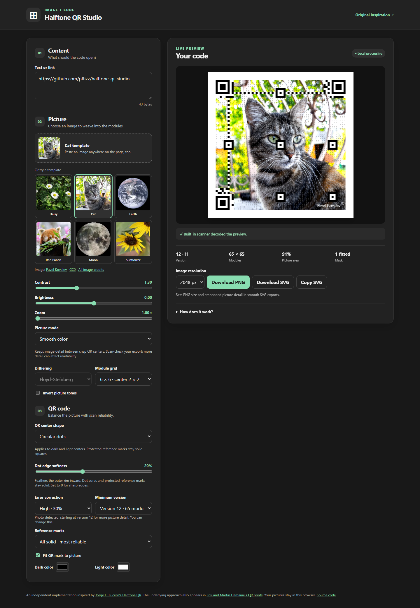

# Halftone QR Studio

<!-- bright-builds-rules-readme-badges:begin -->

<!-- Managed upstream by bright-builds-rules. If this badge block needs a fix, open an upstream PR or issue instead of editing the downstream managed block. Keep repo-local README content outside this managed badge block. -->

[](https://github.com/pRizz/halftone-qr-studio)
[](https://github.com/pRizz/halftone-qr-studio/actions/workflows/ci.yml)
[](./LICENSE)
[](./package.json)
[](https://www.typescriptlang.org/)
[](https://vite.dev/)
[](https://github.com/bright-builds-llc/bright-builds-rules)
[](https://openlinks.us/)

<!-- bright-builds-rules-readme-badges:end -->

Put a picture into a QR code. The generator runs locally in your browser and exports PNG and SVG.

[](https://prizz.github.io/halftone-qr-studio/)

The [live website](https://prizz.github.io/halftone-qr-studio/) with the Cat template in smooth color mode, circular QR dots, and 20% edge softness. Cat photo by [Pavel Kovalev](https://commons.wikimedia.org/wiki/File:Portrait_of_a_cat1.jpg), [CC0](https://creativecommons.org/publicdomain/zero/1.0/).

This is an **independent implementation** inspired by [Jorge C. Lucero's Halftone QR](https://lucerojc.github.io/halftone-qr/). Its source code was not copied. The technique is also discussed in [Erik and Martin Demaine's QR prints](https://erikdemaine.org/prints/QR/) and Chu, Chang, Lee, and Mitra, *Halftone QR Codes* (ACM Transactions on Graphics, 2013).

## Run locally

Requires Node.js 22.12 or newer.

```sh
npm install
npm run dev
```

Run `npm test` for core checks and `npm run build` for a production build. The build is a static site in `dist/`.

## Current features

- Text or URL input, local image upload, drag and drop, and paste
- Daisy, Cat, Earth, Red Panda, Moon, and Sunflower templates, with a random starting image on each visit
- Contrast, brightness, zoom, inversion, and four dithering modes
- Circular or square QR centers with adjustable inward edge softness, subtly enabled by default
- Four module layouts, four error correction levels, minimum version, reference mark protection, and picture aware QR mask selection
- Automatic larger code for photos, color selection, browser scan feedback, and PNG/SVG export

The scan check is a useful signal, not a guarantee. Check the final download with the camera and lighting conditions in which it will be used.

## Project layout

`src/qr.ts` wraps the QR encoder and identifies fixed QR patterns. `src/image.ts` samples and dithers pictures. `src/halftone.ts` combines picture cells and QR modules. `src/export.ts` makes canvas and SVG output. `src/main.ts` owns the UI.

## Credits and licenses

The application code is MIT licensed under [LICENSE](LICENSE). Template images are public domain or CC0; their sources, creators, and modifications are listed in [image credits](public/templates/CREDITS.txt). The QR encoder at `src/vendor/qrcodegen.ts` is Project Nayuki's [QR Code generator](https://github.com/nayuki/QR-Code-generator) at commit `bcfe1b018cec5f1f91b5705eca5bb4cdd34e9f8d`, licensed under MIT; its full notice is preserved in that file. QR reading uses [jsQR](https://github.com/cozmo/jsQR), licensed under Apache 2.0 and installed from npm. Neither Jorge C. Lucero nor Project Nayuki is affiliated with this project.
